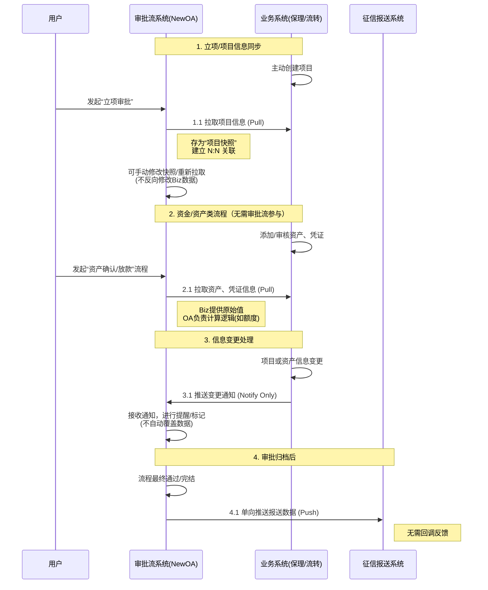

# 项目背景与范围说明书 (Project Context & Scope)

## 1. 项目概述 (Overview)
本文件描述了公司新一代**“项目审批系统” (New OA)** 的建设背景、目标及系统边界。

### 1.1 当前现状
公司原有一套名为“三合一”的遗留系统，历史上集成了保理业务、多级流转业务和 OA 审批功能。
* **演变状态：** 目前，**保理业务系统**和**多级流转系统**已完成独立拆分，建立了独立的业务系统。
* **遗留问题：** “三合一”系统中剩余的 OA 审批模块技术栈老旧，仅作为遗留入口存在。

### 1.2 核心痛点 (Pain Points)
1.  **技术架构老化：** 系统臃肿，页面加载缓慢，并发处理能力不足，严重阻碍办公效率。
2.  **用户体验缺失：** 缺乏系统的交互设计，流程操作反直觉，导致用户录入困难。
3.  **业务脱节：**
    * 字段定义为历史临时方案，与当前独立的业务系统（保理/多级流转）数据结构不匹配。
    * 功能冗余，残留了大量已废弃的业务代码。

## 2. 项目目标 (Objectives)
构建一套**全新的、高效的审批系统**，旨在实现“一个系统，多主体使用，全流程打通”。

* **多主体支持 (Multi-Tenant):** 支持公司内部多个主体（子公司/部门）共用一套系统，实现数据与流程的隔离或复用。
* **流程重构 (Process Re-engineering):** 清洗冗余字段，重新设计符合业务现状的表单与流程。
* **系统互联 (Interconnectivity):** 
    * 向上承接业务系统的审批请求（数据拉取）。
    * 向下分发审批结果（数据推送）。

## 3. 系统集成架构 (System Integration Context)

新系统处于业务流转的核心枢纽位置，涉及与三个外部系统的交互。

### 3.1 宏观集成图 (Context Diagram)

### 3.2 详细交互逻辑 (Interaction Logic)

根据业务性质，系统间采用不同的交互策略：

#### A. 与上游业务系统（保理/流转）的交互

采用 **“拉取 (Pull) + 异步通知 (Notify)”** 模式，而非实时双向同步。

1. **发起与拉取 (Init & Pull):**
   - 用户在 OA 发起流程（如“立项”、“放款”）。
   - OA 根据指令主动调用业务系统接口，**拉取** 项目信息、资产信息或凭证信息。
   - **关键规则：** OA 系统仅进行**计算**和**审批**，资产/凭证的原始数据的处理和审核由业务系统负责。
2. **关联绑定 (Binding):**
   - OA 审批单与业务系统项目建立关联。
   - **N:N 关系：** 审批系统的项目与业务系统的项目是多对多关系（如分期立项）。
   - **快照机制：** OA 存储的数据为“快照”。若业务端数据变更，OA 支持“手动重新获取”以更新快照，或在流程未结束前修改关联。
3. **变更通知 (Change Notification):**
   - 若业务系统端的项目或资产信息发生变更，业务系统主动推送**通知**给 OA。
   - OA 接收通知后进行标记或提醒，**不自动**覆盖已录入的数据，需人工确认。

#### B. 与下游系统（征信报送）的交互

采用 **“单向推送 (Fire-and-Forget)”** 模式。

1. **触发时机：** 仅在 OA 系统内审批流程彻底**通过**后触发。
2. **数据流向：** OA 系统 -> 征信报送系统。
3. **反馈机制：** 征信系统接收数据后，**不需要**反向给 OA 推送处理结果或状态，OA 任务即刻完成。

## 4. 关键业务规则 (Business Rules)

为确保开发逻辑准确，需遵循以下约束：

1. **数据所有权 (Data Ownership):** * **业务系统**拥有项目、资产、凭证的**唯一事实来源 (Source of Truth)**。
   - **审批系统**拥有审批流转状态、审批意见、以及基于原始数据计算出的中间结果（如放款额度计算结果）的所有权。
2. **解耦原则:** *OA 系统的字段修改不应直接污染业务系统的原始数据。
   - 征信报送的失败不应回滚 OA 的审批通过状态（建议采用消息队列异步处理）。
3. **多主体数据隔离:** 系统设计必须在数据库层面支持主体标识（Tenant ID/Company ID），确保不同主体间的数据不可见且流程可配置。