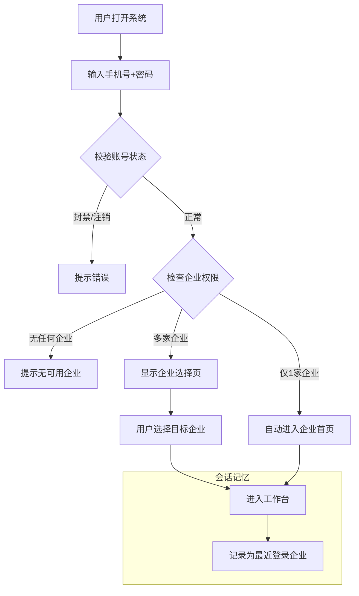

# 系统架构与基础交互规约 (System Architecture & Interaction)

## 1. 核心概念与领域模型 (Domain Concepts)

### 1.1 账号与主体模型 (Account-Subject Model)
本系统采用 **“账号实体与自然人解耦”** 的多租户架构设计 。

#### 核心定义
* **账号 (Account):** 系统管理的最小单元。现实中的一个自然人可能拥有多个账号（如多职能分身），拥有唯一的身份标识 (ID) 。
* **主体 (Subject):** 企业或组织单元。
* **关系 (Relationship):** **N:1 (多对一)** 。一个账号可以绑定到多个不同的主体下，但在特定会话中仅能激活一个主体。

#### 隔离与映射
| 维度         | 说明                                                         |
| :----------- | :----------------------------------------------------------- |
| **数据隔离** | 账号在不同主体下的数据完全物理或逻辑隔离 。                  |
| **角色隔离** | 同一账号在主体 A 可能是“经理”，在主体 B 可能是“普通员工”，权限互不干扰 。 |

### 1.2 账号生命周期管理
本系统区分 **平台级管控** 与 **主体级管控** 。

#### A. 引入机制
* **非自动关联:** 账号需由主体内的管理员主动发起添加/邀请，才可进入该主体 。

#### B. 退出与封禁机制
| 操作类型       | 作用域 | 触发角色   | 逻辑行为                                                | 数据处理                                          |
| :------------- | :----- | :--------- | :------------------------------------------------------ | :------------------------------------------------ |
| **主体级解绑** | 租户层 | 主体管理员 | 仅切断当前主体关联，不影响其他主体登录 。               | **软删除 (Soft Delete):** 保留审批记录用于审计 。 |
| **平台级停用** | 平台层 | 超级管理员 | **全线熔断**，禁止登录整个平台，所有主体访问即刻失效 。 | 账号状态标记为 Disabled。                         |

---

## 2. 权限体系 (RBAC & Administration)

系统采用 **“平台-主体”双层隔离** 管理模式 。

### 2.1 第一层级：系统超级管理员 (System Super Admin)
* **定位:** 上帝视角，平台运营方，全局唯一 。
* **职责:**
    * 主体生命周期管理（开通、冻结、配额配置）。
    * 全局风控（封禁违规账号）。
    * **数据穿透:** 拥有“开天眼”权限，可查看租户内部具体业务数据 。

### 2.2 第二层级：主体管理员 (Subject Admin)
* **定位:** 企业内部最高权限，随主体创建自动生成 。
* **职责:**
    * 组织架构搭建 (Department/Role) 。
    * 人员准入（添加/解绑成员）。
    * 业务流程配置 。
* **边界:** 严格限制在当前主体 ID 范围内，无法感知其他主体 。

---

## 3. 登录与访问控制 (Access Control)

### 3.1 登录流程规约
用户通过 **手机号 + 密码** 方式登录。

## 3.2 数据控制

​	系统支持用户账号归属多个企业，未配置企业分组时，用户可查看其所有归属企业的待办和消息的全量数据（含当前及历史数据，如待处理、已发起、待推送、消息，不包括项目信息和征信信息）；
​	技术人员在系统后台配置企业分组（支持创建 / 修改 / 删除分组，例：将 A、B 企业归为一组，C 企业单独设为一组）；
​	分组配置生效后，用户登录某一归属企业时，系统自动匹配该企业所属分组，仅展示该分组内所有企业的全量数据（含当前及历史数据）；
​	示例：用户登录 A 企业（所属分组为 AB 组），仅可见 A、B 企业数据；登录 C 企业（所属分组为 C 组），仅可见 C 企业数据；
​	未在当前登录企业所属分组的其他企业数据（含历史数据）完全不可访问，无查询、跳转入口；
​	仅技术人员拥有分组配置权限，用户无配置权限，仅按后台规则查看对应数据。